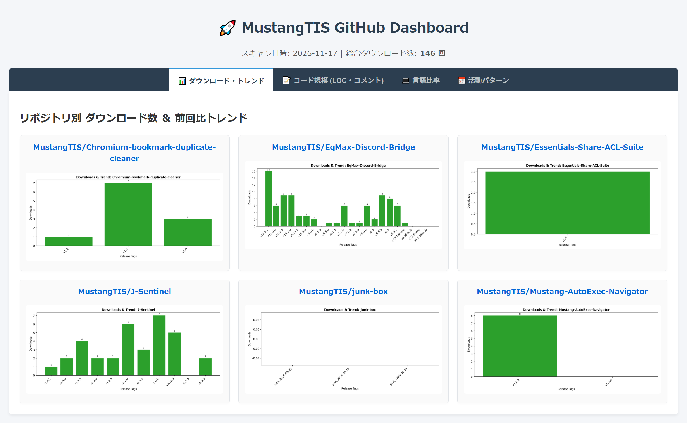

# 🚀 GitHub Dashboard (`github_dashboard.py`)


-green)


GitHubリポジトリの各種統計情報（リリースダウンロード数・コード行数・使用言語比率・コミット活動パターン）を自動集計し、綺麗で見やすいタブ式HTMLダッシュボードを生成するPythonスクリプトです。



---

## ✨ 主な機能

- **📊 ダウンロード・トレンド分析**: リポジトリごとのリリースダウンロード数と、前回スキャン時からの差分（前回比）を可視化。
- **📝 コード規模 (LOC) 解析**: ソースコードの純行数、コメント行数、空白行数をファイルツリーから自動集計。
- **💻 言語比率分析**: リポジトリ別および全リポジトリ合算の使用言語比率（バイト数ベース）を円グラフで表示。
- **📅 コミット活動パターン**: 曜日ごとのコミット傾向を分析。
- **🌐 タブ式HTML出力**: すべてのグラフとデータが綺麗にまとまったモダンなダッシュボードを自動生成。各カードからGitHubの該当ページへワンクリックでアクセス可能。
- **🔄 マルチOS対応 ＆ 自動設定**: Windows、macOS、Linuxに対応し、初回実行時に設定ファイルを自動生成する親切設計。

---

## 🛠️ 動作環境・必要要件

- **Python**: `3.x`
- **必須ライブラリ**: `matplotlib`

### ライブラリのインストール
以下のコマンドで必要なライブラリをインストールしてください。
```bash
pip install matplotlib

```

---

## 🔑 事前準備: GitHub Personal Access Token の取得

本ツールでリポジトリやプライベート情報を取得するためには、GitHubのアクセストークンが必要です。

[Personal Access Tokens 設定ページ](https://github.com/settings/tokens)

1. GitHubにログインし、**Settings** > **Developer settings** > **Personal access tokens** (Fine-grained tokens または Tokens (classic)) に移動します。
2. 新しいトークンを生成します（Classicの場合は `repo` スコープ、Fine-grainedの場合はリポジトリの読み取り権限などを付与してください）。
3. 発行されたトークン（`ghp_...` など）を控えておきます。

---

## ⚙️ 使い方・導入手順

### 1. スクリプトの配置

適当なフォルダ（またはGitHubからクローンしたディレクトリ）に `github_dashboard.py` を配置します。

### 2. 初回実行による設定ファイルの自動生成

スクリプトを初めて実行すると、同じ階層に設定ファイルのひな形 **`config.net.json`** が自動生成され、一度安全のために停止します。

```bash
python github_dashboard.py

```

### 3. 設定ファイルの編集

生成された `config.net.json` をテキストエディタで開き、あなたのGitHubトークンと、HTML・グラフの出力先フォルダパスを設定します。

**`config.net.json` の設定例:**

```json
{
  "github_token": "ghp_あなたのGitHubトークンをここに貼り付け",
  "output_dir": "D:/path/to/your/output_folder"
}

```

*※Windows環境のパス区切りも、スラッシュ (`/`) で記述するとエスケープエラーを防げます。*

### 4. ダッシュボードの生成

設定後、再度スクリプトを実行します。

```bash
python github_dashboard.py

```

指定した `output_dir` フォルダ内に `index.html` や各種グラフ画像、JSONデータが生成されます。ブラウザで `index.html` を開くことで、いつでも最新のダッシュボードを確認できます。

---

## 🔄 自鯖（自動化・定期実行）での運用

自鯖（Windows Server や Linux等）の **タスクスケジューラ** や **cron** に本スクリプトの実行を登録し、出力先をWebサーバーのドキュメントルート（公開フォルダ）に直指定しておくことで、いつでもブラウザからリアルタイムなGitHubダッシュボードを閲覧できるようになります。

---

## 📜 ライセンス

本ソフトウェアは [MIT License](https://www.google.com/search?q=./LICENSE) の下で公開されています。