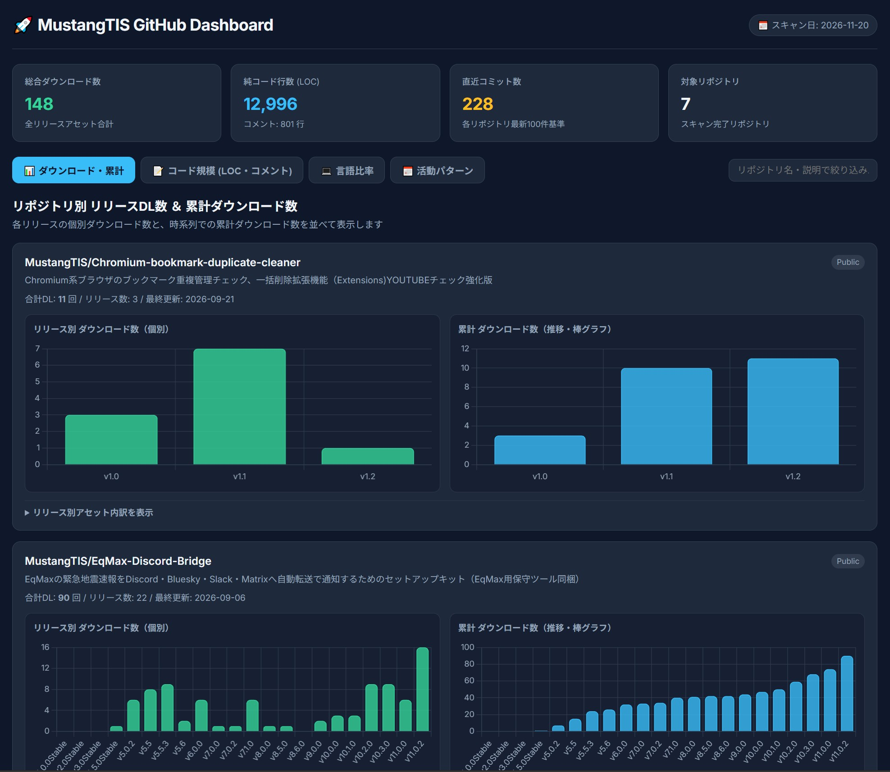
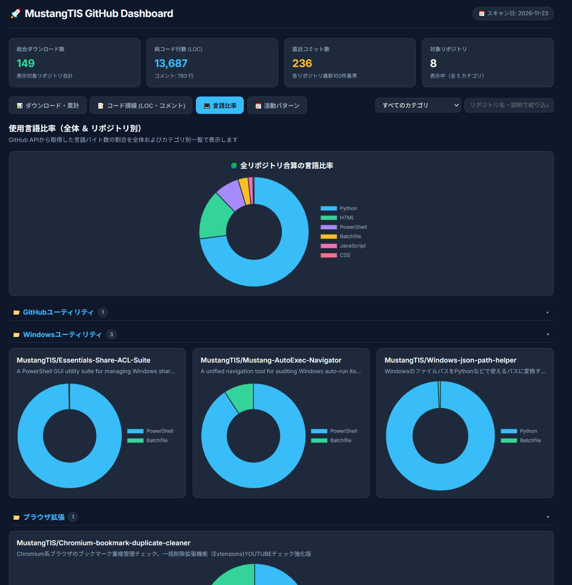

# 🚀 GitHub Dashboard (`github_dashboard.py`)


GitHubリポジトリの各種統計情報（リリース別・累計ダウンロード数、コード行数、使用言語比率、コミット活動パターン）を自動集計し、ダークテーマのインタラクティブなWebダッシュボード（`index.html` + Chart.js）とJSONデータを生成するPythonスクリプトです。





<!-- 言語比率タブのプレビューを併載する場合はこちらを有効化してください

-->

---

[](https://github.com/MustangTIS/GitHub-Dashboard/releases/latest)

---

## ✨ 主な機能（`v2.0.0`）

- **📈 KPIサマリーカード**: 総合ダウンロード数、純コード行数（コメント数内訳付き）、直近コミット数、対象リポジトリ数を上部に一覧表示。
- **📊 ダウンロード・累計（2グラフ構成）**:
  - リリースごとの個別ダウンロード数を棒グラフで表示（ホバー時に前回スキャン時からの差分を表示）。
  - 時系列の累計ダウンロード数を棒グラフで表示。
  - 折りたたみ（`<details>`）からリリース別のアセット内訳を確認可能。
- **📝 コード規模 (LOC) 解析**: ソースコードの純行数、コメント行数、空白行数をファイルツリーから自動集計。
- **💻 言語比率分析**: 全リポジトリ合算およびリポジトリ別の使用言語比率（バイト数ベース）をドーナツグラフで表示。
- **📅 コミット活動パターン**: ローカルタイムゾーン基準で曜日別（Mon–Sun）と時間帯別（00h–23h）のコミット傾向を集計。
- **🔍 絞り込み検索**: リポジトリ名や説明文（`description`）でリアルタイムに絞り込み可能。
- **🌐 インタラクティブなWeb出力**: Chart.jsによるグラフ描画とタブ切り替えに対応したダッシュボードHTMLを自動生成。各リポジトリ名からGitHubの該当ページへワンクリックでアクセス可能。
- **🔄 マルチOS対応 ＆ 自動設定**: Windows、macOS、Linuxに対応し、初回実行時に設定ファイルを自動生成。

---

## 🛠️ 動作環境・必要要件

- **Python**: `3.x`（標準ライブラリのみで動作。PNG画像出力用の `matplotlib` は不要になりました）
- **閲覧環境**: 生成された `index.html` を開く際に、Chart.js の読み込みのためインターネット接続が必要です。

---

## 🔑 事前準備: GitHub Personal Access Token の取得

本ツールでリポジトリやプライベート情報を取得するためには、GitHubのアクセストークンが必要です。

[Personal Access Tokens 設定ページ](https://github.com/settings/tokens)

1. GitHubにログインし、**Settings** > **Developer settings** > **Personal access tokens** (Fine-grained tokens または Tokens (classic)) に移動します。
2. 新しいトークンを生成します（Classicの場合は `repo` スコープ、Fine-grainedの場合はリポジトリの読み取り権限などを付与してください）。
3. 発行されたトークン（`ghp_...` など）を控えておきます。

---

## ⚙️ 使い方・導入手順

### 1. スクリプトの配置

適当なフォルダ（またはGitHubからクローンしたディレクトリ）に `github_dashboard.py` を配置します。

### 2. 初回実行による設定ファイルの自動生成

スクリプトを初めて実行すると、同じ階層に設定ファイルのひな形 **`config.net.json`** が自動生成され、一度安全のために停止します。

```bash
python github_dashboard.py

```

### 3. 設定ファイルの編集

生成された `config.net.json` をテキストエディタで開き、あなたのGitHubトークンと、HTML・JSONの出力先フォルダパスを設定します。

**`config.net.json` の設定例:**

```json
{
  "github_token": "ghp_あなたのGitHubトークンをここに貼り付け",
  "output_dir": "D:/path/to/your/output_folder"
}

```

*※Windows環境のパス区切りも、スラッシュ (`/`) で記述するとエスケープエラーを防げます。パス変換やコピーをGUIで行いたい場合は [Windows-json-path-helper](https://github.com/MustangTIS/Windows-json-path-helper) も活用できます。*

```

### 4. ダッシュボードの生成

設定後、再度スクリプトを実行します。

```bash
python github_dashboard.py

```

指定した `output_dir` フォルダ内に `index.html` と `all_repositories_stats.json` が生成されます。ブラウザで `index.html` を開くことで、いつでも最新のダッシュボードを確認できます。

---

## 🔄 自鯖（自動化・定期実行）での運用

自鯖（Windows Server や Linux等）の **タスクスケジューラ** や **cron** に本スクリプトの実行を登録し、出力先をWebサーバーのドキュメントルート（公開フォルダ）に直指定しておくことで、いつでもブラウザからリアルタイムなGitHubダッシュボードを閲覧できるようになります。

※プライベートリポジトリを含むトークンで実行した場合、生成される `index.html` や `all_repositories_stats.json` に該当リポジトリの情報が含まれます。Web公開する場合は公開対象や出力先にご注意ください。

---

## 📜 ライセンス

本ソフトウェアは [MIT License](https://www.google.com/search?q=./LICENSE) の下で公開されています。